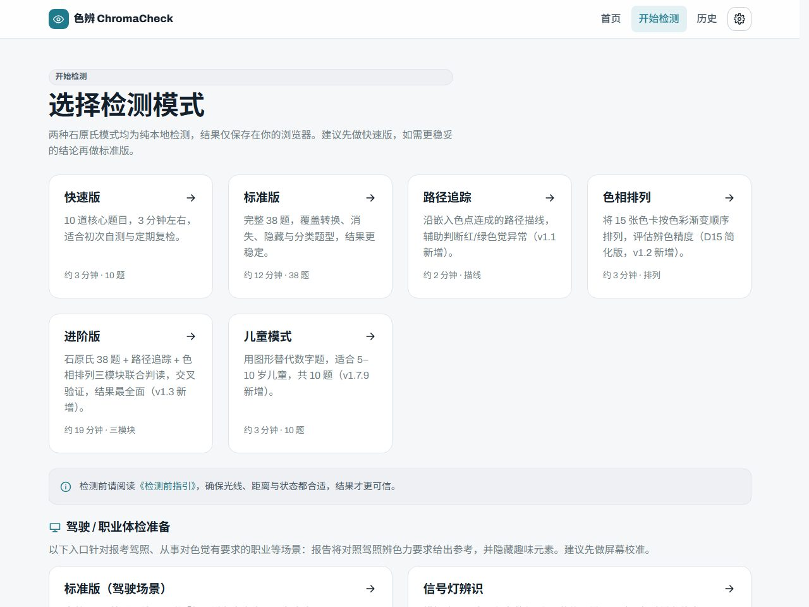
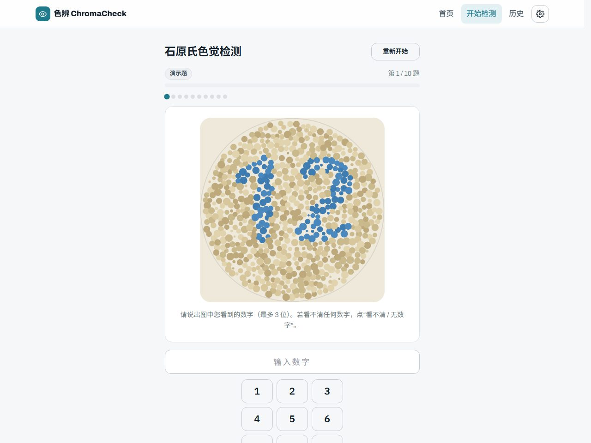

# 色辨 ChromaCheck

> 一眼辨色，科学筛查 — 在线色觉检测 Web 应用

[][website]
[][ci]
[](https://nextjs.org/)
[](https://www.typescriptlang.org/)
[](https://tailwindcss.com/)
[](#license)

[website]: https://chroma.appti.cn/
[ci]: https://github.com/sutchan/ChromaCheck/actions/workflows/ci.yml

色辨（ChromaCheck）是基于 Web 的在线色觉检测工具，通过标准化石原氏色盲检测图与多种测试范式，帮助用户快速、便捷地筛查色觉异常。纯本地运行、无需注册，检测数据默认仅存储于浏览器。

**在线试用**：<https://chroma.appti.cn/> — 打开即用，无需注册，检测数据仅存于本地浏览器。

**规范域名（canonical）**：<https://chroma.appti.cn>（`lib/site.ts` 的 `SITE_URL`，用于 metadata / sitemap / robots / OG URL）。旧域名 `chromacheck.app` 与 `chroma.ewuse.com` 由 `next.config.mjs` 308 永久重定向至规范域名。

> **当前版本 v1.17.7**（版本单一来源见 `VERSION`）。已实现能力见下方「功能特性」；权威规范见 [docs/SPEC.md](docs/SPEC.md)。

## 功能特性

- 石原氏数字图测试（快速 10 / 标准 38 题）与规则化初筛（总体结论 / 程度 / 判读稳定性 / 维度参考值）；答题支持实体键盘数字键直接输入（数字键追加、`Backspace` 删除、`Enter` 提交，附多语言操作提示）
- 路径追踪描线、色相排列（D15）、进阶联合判读、信号灯辨识、儿童图形识别、批量检测等多种范式
- 结果可视化（维度条形图 / 答题明细）与报告导出（PNG / 打印 PDF / 复制文字 / 色觉人格分享卡）
- 检测历史本地存储，支持多档案、JSON 导出导入与汇总 CSV；答题草稿本机断点续测
- SEO / GEO：sitemap / robots / llms.txt 与 llms-full.txt 全文索引、站点级结构化数据、PNG 社交分享图与 SSR 关键事实块
- 响应式 + 深色模式 + 色觉安全模式 + 减少动效；结果页五种色觉视角切换（首页模拟器为 4 种）
- 趣味体验包（进度点阵 / 章末轻科普 / 色觉人格分享卡 / 旅人称号），可一键关闭
- 驾驶场景（`scene=driver`）与合规提示、无障碍跳转链接、自托管字体、FAQPage 结构化数据与页面错误边界
- 三语支持（简体中文默认 / 繁體中文 / English，i18n）、PWA 离线兜底、Google Analytics 匿名访问统计

> **判读能力边界**：题库仅含演示题与消失型题（另含 3 张常规数字题），未实现真正的双数字变形 / 隐藏版，因此**不能可靠区分红 / 绿 / 蓝黄异常类型**；异常类型字段在无转换/分类题命中时输出 null（未分型，v1.15.1 起不再默认输出「绿色弱/盲」），三轴中的 tritan 为推算参考值。结果仅供初筛参考，不能替代专业医学诊断。

## 当前状态（更新于 2026-11-27 / v1.17.7）

- **最新功能变更**：迁移 Next.js 16 / React 19，生产依赖 critical 审计归零；首页主 CTA 先进入 `/guide`；补齐内容型文案繁体字段；规范域名收敛至 `chroma.appti.cn`；E2E 本地连续三次通过，PWA 离线覆盖完成验证。详见 [tasks-done.md](docs/tasks-done.md) §九。
- **已知边界**：组件测试未引入；判读未分型；CI 连续三次运行由外部触发验证；本地 `next build` 可能受 IDE 安全删除护栏拦截（CI 不受影响）。
- **待办事项**：唯一来源为 [docs/tasks.md](docs/tasks.md)。当前活跃项仅 O-10 / O-11 两个产品远景；本文件不维护第二份任务清单。
- **关键决策**：纯前端 + 本地优先、无服务端业务 API；检测数据不上传，仅 GA4 匿名访问统计；三语优先级简中 > 繁中 > 英文；字体真自托管；7 个扁平 `localStorage` 键；版本与 build 仅在页脚展示；任务状态单一来源；CI 使用 `npm ci` 并保留覆盖率 / E2E 门禁。

## 界面预览






## 技术栈

Next.js 16（App Router）+ TypeScript + Tailwind CSS（设计令牌 / CSS 变量，支持深色与色觉安全模式）。图表用内联 SVG，导出用 Canvas + 浏览器打印，不引入重型运行时依赖。

| 类别 | 技术 |
| --- | --- |
| 框架 | Next.js 16（App Router） |
| 语言 | TypeScript 5 |
| 样式 | Tailwind CSS 3 + 设计令牌 |
| 图表 | 内联 SVG |
| 导出 | Canvas（PNG）+ `window.print()`（PDF） |
| 测试 | Vitest |
| 部署 | Vercel / 任意 Node 托管 |

架构详见 [docs/ARCHITECTURE.md](docs/ARCHITECTURE.md)；权威总纲见 [docs/SPEC.md](docs/SPEC.md)。

## 快速开始

要求 Node.js 22 LTS（最低 ≥ 18.17；CI 固定 Node 22）。

```bash
npm ci               # 安装依赖（仓库已提交 package-lock.json，CI 与 Dockerfile 固定 npm ci）
npm run dev          # 开发服务器 → http://localhost:3000
npm run build && npm run start   # 构建并启动生产版本
npm run lint && npm run type-check && npm test   # 代码检查 / 类型检查 / 单元测试
npm run test:coverage                           # V8 覆盖率门禁（lines 80 / functions 75 / branches 70 / statements 80）
npm run check:docs && npm run check:openapi      # 文档链接 / 版本位与 OpenAPI 路径校验
npx playwright install chromium && npm run e2e   # 主链路 E2E（CI 已接入）
```

## 项目结构

```
chromacheck/
├── app/            # 页面：首页（色觉模拟 + FAQ 区块）、检测指引、模式选择、
│                   #   各测试（ishihara / path-tracking / hue-arrangement / advanced / signal / batch / child）、
│                   #   结果、历史、科普、隐私、离线兜底、PWA manifest 与 SEO（robots / sitemap / llms.txt）；
│                   #   另有 4 处 error.tsx 错误边界与 app/layout.tsx 的无障碍跳转链接
├── components/     # common / layout（导航·页脚·主题·语言·设置面板）/ home /
│                   #   test / result / history / guide / learn / offline / privacy /
│                   #   analytics / pwa / seo（另含根级 NotFoundClient.tsx）
├── lib/            # types / site / 题库（questions + questions/）/
│                   #   判读（scoring、scoring-text、path-scoring、hue-scoring、advanced-scoring、
│                   #         signal-scoring、child-scoring、path-field）/
│                   #   画布导出（report-canvas、sharecard-canvas）/ 趣味（fun、sharecard）/
│                   #   i18n/（简繁英字典与 t()）/ profile / export-import / ishihara / storage /
│                   #   learn-data / privacy-data / license / format / analytics /
│                   #   *.test.ts（Vitest 17 文件 116 例）
├── public/         # PWA sw.js / og-default.svg / og-default.png（1200×630 社交图）/ icons/（3 个 PNG 图标）
├── scripts/        # check-openapi.mjs / check-docs.mjs（CI 门禁）
├── e2e/             # Playwright 主链路回归（main-flow.spec.ts）
├── reports/         # 文档 / OpenAPI 校验产物
├── Dockerfile / docker-compose.yml   # 自托管镜像与编排模板（node:22-alpine + standalone）
├── playwright.config.ts             # Playwright E2E 配置（baseURL 127.0.0.1:3000）
├── docs/           # 项目文档（SPEC.md 为权威总纲）+ images/ 界面截图
├── prototype/      # 高保真静态原型（设计验证参考，无运行依赖）
├── .github/        # 贡献指南 + CI workflow + issue/PR 模板
└── 配置与元数据     # package.json / package-lock.json / next.config.mjs / tailwind / postcss /
                    #   tsconfig / eslint / vitest.config.ts / vitest.setup.ts / VERSION /
                    #   .env.example / metadata.json / .gitignore / LICENSE
```

## 文档

**文档索引**（按使用顺序）：

| 场景 | 文档 |
|------|------|
| 权威规范 / 术语裁决 | [docs/SPEC.md](docs/SPEC.md) |
| 产品需求与用户流程 | [docs/PRD.md](docs/PRD.md) |
| 架构设计 / 技术选型 | [docs/ARCHITECTURE.md](docs/ARCHITECTURE.md) |
| 功能模块 / 业务流程图 | [docs/FEATURES.md](docs/FEATURES.md) |
| 安装部署 / 多环境 / 验证 | [docs/DEPLOYMENT.md](docs/DEPLOYMENT.md) |
| 接口文档 / OpenAPI | [docs/API.md](docs/API.md) · [docs/openapi.yaml](docs/openapi.yaml) |
| 数据结构 / 存储键 | [docs/DATA-SPEC.md](docs/DATA-SPEC.md) |
| 测试策略与门禁 | [docs/TESTING.md](docs/TESTING.md) |
| 用户操作指南 | [docs/USER-GUIDE.md](docs/USER-GUIDE.md) |
| FAQ / 故障排除 | [docs/FAQ.md](docs/FAQ.md) · [docs/TROUBLESHOOTING.md](docs/TROUBLESHOOTING.md) |
| 隐私与合规 | [docs/PRIVACY.md](docs/PRIVACY.md) |
| 路线图 / 优化建议 | [docs/ROADMAP.md](docs/ROADMAP.md) |
| 未完成任务（单一来源） | [docs/tasks.md](docs/tasks.md) · [docs/tasks-done.md](docs/tasks-done.md) |

开发约定见 [.github/CONTRIBUTING.md](.github/CONTRIBUTING.md)，版本记录见 [CHANGELOG.md](CHANGELOG.md)。

## 高保真原型

纯静态、无依赖，浏览器直接打开：`prototype/prototype.html`（可交互 + 色觉模拟）、`wireframes.html`（组件库）、`design-system.html`（设计系统）、`interaction.html`（交互标准）。

## 开发规范

提交遵循 [Conventional Commits](https://www.conventionalcommits.org/)：`feat` / `fix` / `docs` / `style` / `refactor` / `perf` / `test` / `chore`。分支：`main`（生产）/ `develop`（可选）/ `feature/*`；当前仓库仅维护 `main`。

## 部署

**Vercel（推荐）**：导入仓库，构建命令自动识别为 `next build`。面向用户的主要可选环境变量为 `NEXT_PUBLIC_GA_ID`（置空即停用 GA4）；另有站点验证变量 `NEXT_PUBLIC_GOOGLE_SITE_VERIFICATION` / `NEXT_PUBLIC_BING_SITE_VERIFICATION`（见 [docs/DEPLOYMENT.md §5](docs/DEPLOYMENT.md)）。`NEXT_PUBLIC_BUILD_ID` 由 `next.config.mjs` 在构建期自动注入，无需配置。

**Docker**：仓库根目录已提供 `Dockerfile` 与 `docker-compose.yml`（`node:22-alpine` 多阶段构建，`output: 'standalone'` 已配置；见 [docs/DEPLOYMENT.md §3](docs/DEPLOYMENT.md)）。`package.json` 与锁文件已同步，Dockerfile 的 `npm ci` 构建仍待 CI / Preview 验证：

```bash
docker build -t chromacheck . && docker run -p 3000:3000 chromacheck
# 或：docker compose up -d
```

**版本发布**：`push` 到 `main` 且 CI 全绿后自动创建 `v{VERSION}` tag 与 GitHub Release（notes 取自 CHANGELOG，同名 tag 已存在则跳过；详见 [docs/DEPLOYMENT.md §9](docs/DEPLOYMENT.md) 与 SPEC §8.6）。

## 隐私与免责

- 本工具仅用于色觉筛查参考，**不能替代专业医学诊断**。
- 检测结果受屏幕显示、环境光线影响；如结果异常，请前往正规医院眼科检查。
- 检测数据默认仅存于本地浏览器；站点仅发起 Google Analytics 匿名访问统计（不含答题记录与判读结果），详见 [docs/PRIVACY.md](docs/PRIVACY.md)。

## License

[MIT](LICENSE)

## 联系方式

- 项目地址：<https://github.com/sutchan/ChromaCheck>
- 问题反馈：<https://github.com/sutchan/ChromaCheck/issues>

---

*色辨 ChromaCheck — 让每个人都能了解自己的色彩世界*
