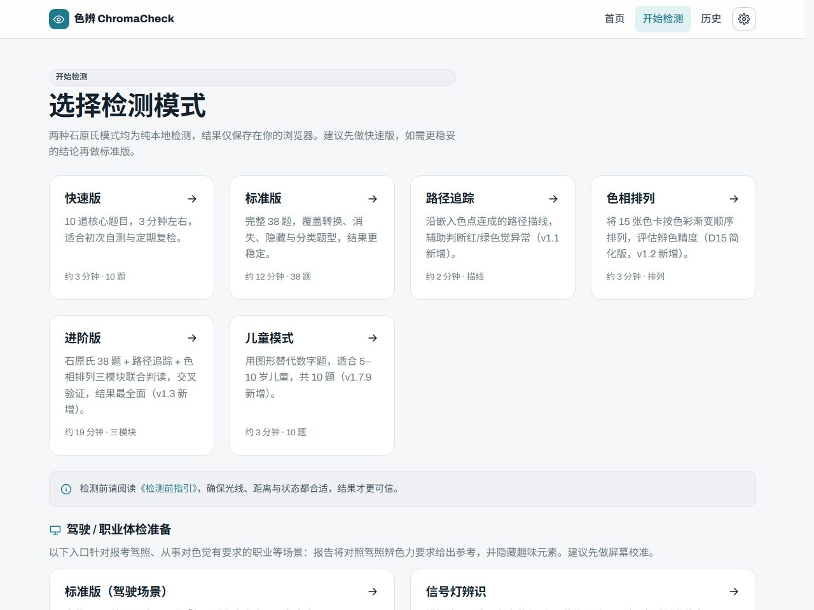
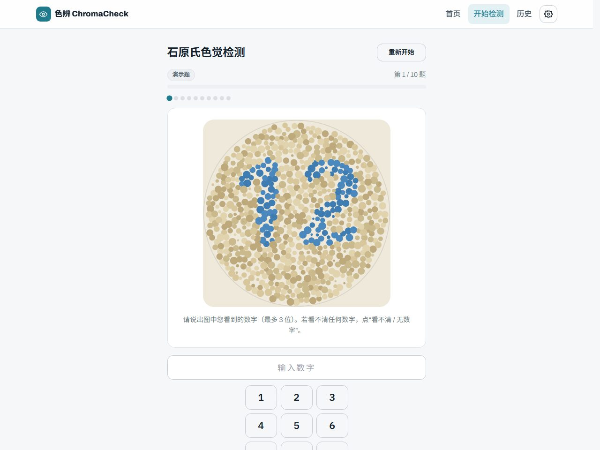

# 色辨 ChromaCheck

> 一眼辨色，科学筛查 — 在线色觉检测 Web 应用

[][website]
[][ci]
[](https://nextjs.org/)
[](https://www.typescriptlang.org/)
[](https://tailwindcss.com/)
[](#license)

[website]: https://chroma.ewuse.com/
[ci]: https://github.com/sutchan/ChromaCheck/actions/workflows/ci.yml

色辨（ChromaCheck）是基于 Web 的在线色觉检测工具，通过标准化石原氏色盲检测图与多种测试范式，帮助用户快速、便捷地筛查色觉异常。纯本地运行、无需注册，检测数据默认仅存储于浏览器。

**在线试用**：<https://chroma.ewuse.com/> — 打开即用，无需注册，检测数据仅存于本地浏览器。

**规范域名（canonical）**：<https://chromacheck.app>（`lib/site.ts` 的 `SITE_URL`，用于 metadata / sitemap / robots / OG URL）；当前与试用入口并存，域名收敛计划待确认。

> **当前版本 v1.16.2**（版本单一来源见 `VERSION`）。已实现能力见下方「功能特性」；权威规范见 [docs/SPEC.md](docs/SPEC.md)。

## 功能特性

- 石原氏数字图测试（快速 10 / 标准 38 题）与规则化初筛（总体结论 / 程度 / 判读稳定性 / 维度参考值）；答题支持实体键盘数字键直接输入（数字键追加、`Backspace` 删除、`Enter` 提交，附多语言操作提示）
- 路径追踪描线、色相排列（D15）、进阶联合判读、信号灯辨识、儿童图形识别、批量检测等多种范式
- 结果可视化（维度条形图 / 答题明细）与报告导出（PNG / 打印 PDF / 复制文字 / 色觉人格分享卡）
- 检测历史本地存储，支持多档案、JSON 导出导入与汇总 CSV；答题草稿本机断点续测
- 响应式 + 深色模式 + 色觉安全模式 + 减少动效；结果页五种色觉视角切换（首页模拟器为 4 种）
- 趣味体验包（进度点阵 / 章末轻科普 / 色觉人格分享卡 / 旅人称号），可一键关闭
- 驾驶场景（`scene=driver`）与合规提示、无障碍跳转链接、自托管字体、FAQPage 结构化数据与页面错误边界
- 三语支持（简体中文默认 / 繁體中文 / English，i18n）、PWA 离线兜底、Google Analytics 匿名访问统计

> **判读能力边界**：题库仅含演示题与消失型题（另含 3 张常规数字题），未实现真正的双数字变形 / 隐藏版，因此**不能可靠区分红 / 绿 / 蓝黄异常类型**；异常类型字段在无转换/分类题命中时输出 null（未分型，v1.15.1 起不再默认输出「绿色弱/盲」），三轴中的 tritan 为推算参考值。结果仅供初筛参考，不能替代专业医学诊断。

## 界面预览






## 技术栈

Next.js 14（App Router）+ TypeScript + Tailwind CSS（设计令牌 / CSS 变量，支持深色与色觉安全模式）。图表用内联 SVG，导出用 Canvas + 浏览器打印，不引入重型运行时依赖。

| 类别 | 技术 |
| --- | --- |
| 框架 | Next.js 14（App Router） |
| 语言 | TypeScript 5 |
| 样式 | Tailwind CSS 3 + 设计令牌 |
| 图表 | 内联 SVG |
| 导出 | Canvas（PNG）+ `window.print()`（PDF） |
| 测试 | Vitest |
| 部署 | Vercel / 任意 Node 托管 |

架构详见 [docs/ARCHITECTURE.md](docs/ARCHITECTURE.md)；权威总纲见 [docs/SPEC.md](docs/SPEC.md)。

## 快速开始

要求 Node.js 22 LTS（最低 ≥ 18.17；CI 固定 Node 22）。

```bash
npm install          # 安装依赖（仓库已提交 package-lock.json，CI 固定 npm install）
npm run dev          # 开发服务器 → http://localhost:3000
npm run build && npm run start   # 构建并启动生产版本
npm run lint && npm run type-check && npm test   # 代码检查 / 类型检查 / 单元测试
```

## 项目结构

```
chromacheck/
├── app/            # 页面：首页（色觉模拟 + FAQ 区块）、检测指引、模式选择、
│                   #   各测试（ishihara / path-tracking / hue-arrangement / advanced / signal / batch / child）、
│                   #   结果、历史、科普、隐私、离线兜底、PWA manifest 与 SEO（robots / sitemap / llms.txt）；
│                   #   另有 4 处 error.tsx 错误边界与 app/layout.tsx 的无障碍跳转链接
├── components/     # common / layout（导航·页脚·主题·语言·设置面板）/ home /
│                   #   test / result / history / guide / learn / offline / privacy /
│                   #   analytics / pwa / seo（另含根级 NotFoundClient.tsx）
├── lib/            # types / site / 题库（questions + questions/）/
│                   #   判读（scoring、scoring-text、path-scoring、hue-scoring、advanced-scoring、
│                   #         signal-scoring、child-scoring、path-field）/
│                   #   画布导出（report-canvas、sharecard-canvas）/ 趣味（fun、sharecard）/
│                   #   i18n/（简繁英字典与 t()）/ profile / export-import / ishihara / storage /
│                   #   learn-data / privacy-data / license / format / analytics /
│                   #   *.test.ts（Vitest 14 文件 97 例）
├── public/         # PWA sw.js / og-default.svg / icons/（3 个 PNG 图标）
├── scripts/        # 构建辅助脚本目录（当前为空）
├── docs/           # 项目文档（SPEC.md 为权威总纲）+ images/ 界面截图
├── prototype/      # 高保真静态原型（设计验证参考，无运行依赖）
├── .github/        # 贡献指南 + CI workflow + issue/PR 模板
└── 配置与元数据     # package.json / package-lock.json / next.config.mjs / tailwind / postcss /
                    #   tsconfig / eslint / vitest.config.ts / vitest.setup.ts / VERSION /
                    #   .env.example / metadata.json / .gitignore / LICENSE
```

## 文档

权威总纲 [docs/SPEC.md](docs/SPEC.md)；分册：PRD / ARCHITECTURE / API / DATA-SPEC / DEPLOYMENT / TESTING / PRIVACY / ROADMAP（均在 `docs/`），任务跟踪 `docs/TASKS.md`、`docs/tasks-done.md`；开发约定见 [.github/CONTRIBUTING.md](.github/CONTRIBUTING.md)；版本记录见 [CHANGELOG.md](CHANGELOG.md)。

## 高保真原型

纯静态、无依赖，浏览器直接打开：`prototype/prototype.html`（可交互 + 色觉模拟）、`wireframes.html`（组件库）、`design-system.html`（设计系统）、`interaction.html`（交互标准）。

## 开发规范

提交遵循 [Conventional Commits](https://www.conventionalcommits.org/)：`feat` / `fix` / `docs` / `style` / `refactor` / `perf` / `test` / `chore`。分支：`main`（生产）/ `develop`（可选）/ `feature/*`；当前仓库仅维护 `main`。

## 部署

**Vercel（推荐）**：导入仓库，构建命令自动识别为 `next build`。唯一可选环境变量为 `NEXT_PUBLIC_GA_ID`（置空即停用 GA4）；`NEXT_PUBLIC_BUILD_ID` 由 `next.config.mjs` 在构建期自动注入，无需配置。

**Docker**：本仓库**不提供 `Dockerfile`**，需先按 [docs/DEPLOYMENT.md §3.1](docs/DEPLOYMENT.md) 在根目录自行创建（`node:22-alpine` + `npm install`，`output: 'standalone'` 已配置），再执行：

```bash
docker build -t chromacheck . && docker run -p 3000:3000 chromacheck
```

**版本发布**：`push` 到 `main` 且 CI 全绿后自动创建 `v{VERSION}` tag 与 GitHub Release（notes 取自 CHANGELOG，同名 tag 已存在则跳过；详见 [docs/DEPLOYMENT.md §9](docs/DEPLOYMENT.md) 与 SPEC §8.6）。

## 隐私与免责

- 本工具仅用于色觉筛查参考，**不能替代专业医学诊断**。
- 检测结果受屏幕显示、环境光线影响；如结果异常，请前往正规医院眼科检查。
- 检测数据默认仅存于本地浏览器；站点仅发起 Google Analytics 匿名访问统计（不含答题记录与判读结果），详见 [docs/PRIVACY.md](docs/PRIVACY.md)。

## License

[MIT](LICENSE)

## 联系方式

- 项目地址：<https://github.com/sutchan/ChromaCheck>
- 问题反馈：<https://github.com/sutchan/ChromaCheck/issues>

---

*色辨 ChromaCheck — 让每个人都能了解自己的色彩世界*
