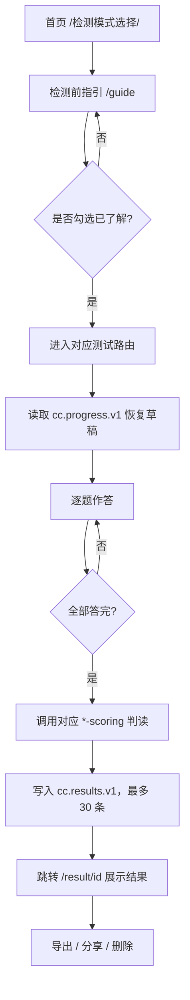
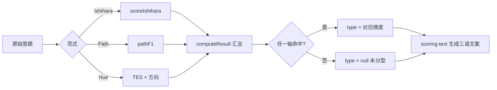
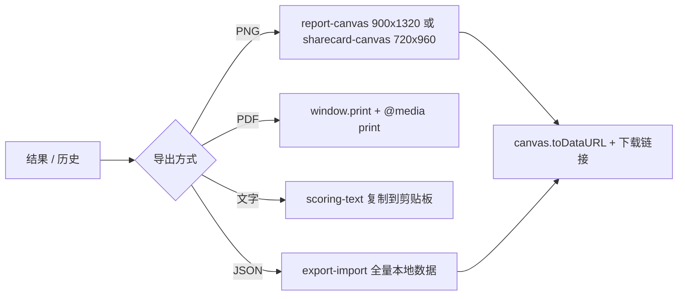

# 色辨 ChromaCheck 功能模块说明

> **文档版本**：v1.17.5 ｜ **实现状态**：v1.0–v1.17.5 已落地能力清单
> **权威依据**：[SPEC.md](./SPEC.md)（规范总纲）、[ARCHITECTURE.md](./ARCHITECTURE.md)（架构）、`lib/` 与 `components/` 实际代码
> **定位**：本文按模块说明「做什么、怎么流转、关键逻辑是什么」；数据结构见 [DATA-SPEC.md](./DATA-SPEC.md)，判读算法权威口径见 SPEC §6。

## 目录

- [1. 模块总览](#1-模块总览)
- [2. 检测类模块](#2-检测类模块)
- [3. 结果与分析模块](#3-结果与分析模块)
- [4. 历史与档案模块](#4-历史与档案模块)
- [5. 导出与分享模块](#5-导出与分享模块)
- [6. 科普与内容模块](#6-科普与内容模块)
- [7. 设置、无障碍与体验模块](#7-设置无障碍与体验模块)
- [8. 国际化模块](#8-国际化模块)
- [9. SEO / GEO 与 PWA 模块](#9-seo--geo-与-pwa-模块)
- [10. 能力边界与已知限制](#10-能力边界与已知限制)

---

## 1. 模块总览

| 模块 | 入口路由 | 核心能力 | 关键实现文件 | 状态 |
|------|----------|----------|--------------|------|
| 石原氏检测 | `/test/ishihara/quick`、`/standard` | 10 / 38 题数字图初筛，键盘直接作答 | `lib/ishihara.ts`、`lib/scoring.ts`、`components/test/IshiharaFlow.tsx` | 已实现 |
| 路径追踪 | `/test/path-tracking/[mode]` | 描线 F1 重合度（`pathF1`，非 IoU）评分 | `lib/path-field.ts`、`lib/path-scoring.ts` | 已实现 |
| 色相排列 D15 | `/test/hue-arrangement/[mode]` | 15 色卡排序，TES 误差与偏差方向 | `lib/hue-scoring.ts`、`lib/questions/hue-arrangement.ts` | 已实现 |
| 进阶联合 | `/test/advanced` | 三范式联合判读，色相优先、路径补充 | `lib/advanced-scoring.ts` | 已实现 |
| 信号灯辨识 | `/test/signal` | 灯色与含义双维度作答 | `lib/signal-scoring.ts`、`lib/questions/signal.ts` | 已实现 |
| 儿童图形 | `/test/child` | 图形识别，三档结论 | `lib/child-scoring.ts`、`lib/questions/child.ts` | 已实现 |
| 批量检测 | `/test/batch` | 本地名单批量记录 | `app/test/batch/page.tsx`、`cc.batch.v1` | 已实现 |
| 结果页 | `/result/[id]` | 维度条形图、答题明细、五种视角 | `components/result/`、`lib/scoring-text.ts` | 已实现 |
| 历史与档案 | `/history` | 本地结果列表、多档案 | `lib/storage.ts`、`lib/profile.ts` | 已实现 |
| 导出与分享 | 历史 / 结果页操作区 | PNG、打印 PDF、JSON 导入导出、CSV 汇总 | `lib/export-import.ts`、`lib/report-canvas.ts`、`lib/sharecard-canvas.ts` | 已实现 |
| 科普 | `/learn`、`/learn/[slug]` | 静态文章列表与详情 | `lib/learn-data.ts`、`components/learn/` | 已实现 |
| 隐私政策 | `/privacy` | 面向用户的隐私说明 | `lib/privacy-data.ts` | 已实现 |
| 设置与无障碍 | 设置面板、主题 / 色觉安全开关 | 深色、色觉安全、减少动效、键盘导航 | `components/layout/SettingsDialog.tsx`、`app/globals.css` | 已实现 |
| 三语 i18n | 设置面板语言切换 | 简中默认 > 繁中 > 英文（界面文案） | `lib/i18n/`、`components/layout/LangProvider.tsx` | 已实现（内容型文案繁体回退简中） |
| SEO / GEO | `sitemap.xml`、`robots.txt`、`llms.txt`、`llms-full.txt` | 站点索引与全文索引 | `lib/seo-routes.ts`、`app/llms.txt/`、`app/llms-full.txt/` | 已实现 |
| PWA | `/offline` | 离线兜底页与 Service Worker | `public/sw.js`、`components/pwa/` | 已实现 |

---

## 2. 检测类模块

### 2.1 检测主流程（通用）

所有检测范式共用「指引 → 答题 → 判读 → 落盘 → 结果」链路；断点续测由 `cc.progress.v1` 提供。

**关键逻辑**

- 进度写入失败静默降级（`lib/storage.ts` L29–37），不阻断答题。
- 石原氏支持实体键盘：数字键追加、`Backspace` 删除、`Enter` 提交；输入框聚焦时交由原生处理。
- 结果数组按时间降序、上限 30 条（`lib/storage.ts` L51/58）。

### 2.2 石原氏检测（Ishihara）

- **核心功能**：快速 10 题 / 标准 38 题；点阵图由 `lib/ishihara.ts` 生成，二色觉模拟矩阵为秩-2 投影。
- **题型事实**：38 题中演示题 3、常规数字题 3、消失题 32；**不存在** transformation / classification / hidden 题（渲染层仅支持单个数字输入）。
- **关键逻辑**：`scoreIshihara` 累计各轴命中；仅在有轴命中时才输出 `type`，无命中时 `type = null`（未分型，v1.15.1 起不再默认输出「绿色弱/盲」）；tritan 维度为 `base * 0.35` 推算参考值。

### 2.3 路径追踪（Path Tracking）

- **核心功能**：在画布上沿路径描线，与预设路径做点集匹配。
- **关键逻辑**：`lib/path-scoring.ts` 以 F1 分数衡量重合度（**不是 IoU，也不是简单命中比例**），`PASS = 70`、`TOL = 0.07`；数学运算在 `lib/path-field.ts`。

### 2.4 色相排列 D15

- **核心功能**：15 色卡按相似度排序，计算色相误差总分（TES）。
- **关键逻辑**：`TES_NORMAL = 20`、`TES_MILD = 40`；偏差方向仅输出 `deutan` / `tritan` / `none`，**不输出 protan**。

### 2.5 进阶联合、信号灯、儿童与批量

| 模块 | 关键逻辑 |
|------|----------|
| 进阶联合 | 色相结果优先，路径 `targets` 作为类型推断补充（`lib/advanced-scoring.ts` L22–45） |
| 信号灯 | `light` 类必须全对才 pass；`meaning` 类答错不判失败（`lib/signal-scoring.ts` L22–49） |
| 儿童图形 | 错 0 题 → `normal`；错 1–2 题 → `suspected_deficiency`；错 ≥3 题 → `suspected_blindness`（`lib/child-scoring.ts` L13–28） |
| 批量检测 | 名单存 `cc.batch.v1`，逐人记录仍走同一套判读与存储 |

---

## 3. 结果与分析模块

- **核心功能**：维度条形图（含参考值）、答题明细、五种色觉视角切换、判读稳定性与程度结论。
- **判读流程图**：

- **关键约束**：结果仅供初筛参考；不能凭在线筛查区分「色盲 / 色弱」或红 / 绿 / 蓝黄类型，确诊需专业仪器。

---

## 4. 历史与档案模块

- `cc.results.v1` 存最近 30 条结果，`cc.profiles.v1` 存家庭档案列表，`cc.activeProfile.v1` 存当前档案 ID。
- 默认档案不可删除（`lib/profile.ts` L103–104）；档案切换仅影响本地记录归属，不涉及服务端账号。
- JSON 导出 / 导入用于跨设备迁移；导入时覆盖同名本地键，操作前应自行备份。

---

## 5. 导出与分享模块

- 所有导出均在浏览器内完成，**不产生任何上传请求**；`Blob` 仅用于本地文件下载。

---

## 6. 科普与内容模块

- `/learn` 列表由 `ARTICLES` 静态生成，详情页 `/learn/[slug]` 使用 `generateStaticParams`。
- 长文本（科普、隐私政策）目前仅简中 / 英文双字段，繁体语言环境回退简体中文（见 §8）。

---

## 7. 设置、无障碍与体验模块

- 主题（深色 / 浅色）、色觉安全模式、趣味体验包开关存于 `cc.settings.v1`。
- 无障碍：跳转到主内容链接、`aria-expanded` / `aria-controls` 手风琴、键盘可达控件、`prefers-reduced-motion`。
- 驾驶场景 `scene=driver` 提供合规提示；严肃场景建议关闭趣味模块。

---

## 8. 国际化模块

- 语言顺序：`zh`（默认）→ `zh-TW` → `en`，`LANGS` 数组顺序即设置面板渲染顺序。
- 界面文案：`lib/i18n/dict.ts` 以简中字典派生 `DictKey`，简体 / 繁体 / 英文三套齐全，缺失键回退简体。
- 内容型文案：`learn-data` / `privacy-data` / 儿童图形标签 / 信号灯题库 / `lib/fun.ts` 的 `LocalizedText` 仅简英双语，繁体回退简中。
- SSR metadata 与 JSON-LD 恒定输出简体（SEO 优先），不随客户端语言切换改变。

---

## 9. SEO / GEO 与 PWA 模块

- `sitemap.ts`、`robots.ts`、`manifest.ts` 为 Next.js 元数据路由，不是业务接口。
- `llms.txt` 与 `llms-full.txt` 是两个静态 GET Route Handler（`force-static`），返回纯文本站点索引与全文索引；详见 [API.md](./API.md) 与 [openapi.yaml](./openapi.yaml)。
- `public/sw.js` 提供离线兜底；`/offline` 为离线页面。
- 站点规范域名为 `https://chroma.appti.cn`（`lib/site.ts` 的 `SITE_URL`）；旧域名 `chromacheck.app` / `chroma.ewuse.com` 通过 `next.config.mjs` 301 收敛。

---

## 10. 能力边界与已知限制

1. 不能可靠区分红 / 绿 / 蓝黄异常类型，也不能区分「色盲 / 色弱」。
2. 题库无转换型 / 隐藏型题，`protanHit` / `deutanHit` 恒 0。
3. 结果最多保存 30 条，超出后最早的被覆盖。
4. 本地存储写入失败不打断流程；结果写入失败在历史页非阻断提示，草稿写入仍静默降级。
5. 无账号体系、无服务端同步；跨设备迁移依赖 JSON 导出 / 导入。
6. 内容型文案繁体非完整翻译，回退简体。
