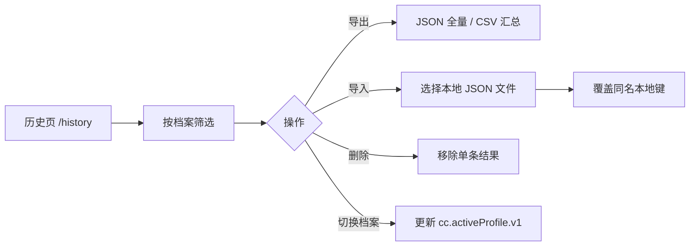
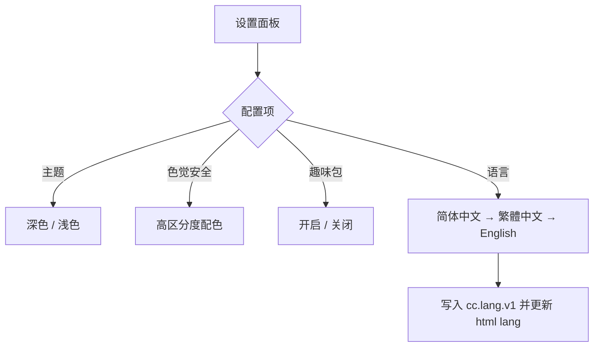

# 色辨 ChromaCheck 用户操作指南

> **文档版本**：v1.17.2 ｜ **适用对象**：终端用户（无需注册、无需安装）
> **依据**：现行路由与组件实现；功能模块说明见 [FEATURES.md](./FEATURES.md)，问题排查见 [TROUBLESHOOTING.md](./TROUBLESHOOTING.md)。

## 目录

- [1. 角色与权限说明](#1-角色与权限说明)
- [2. 操作流程图](#2-操作流程图)
- [3. 详细操作步骤](#3-详细操作步骤)
- [4. 注意事项与免责](#4-注意事项与免责)

---

## 1. 角色与权限说明

**应用内不存在账号体系与角色权限控制**：无登录、无注册、无 session / JWT / Cookie 鉴权，所有访问者拥有完全相同的功能权限。数据以浏览器 `localStorage` 为边界隔离，不跨设备、不跨用户共享。

| 视角 | 身份来源 | 可执行操作 | 不可执行操作 |
|------|----------|------------|--------------|
| 访客 / 检测者 | 打开站点即获得 | 全部检测范式、查看本机历史、导出 / 导入、切换语言与主题、管理本地档案 | 查看他人数据、跨设备同步、云端存储 |
| 本地档案使用者 | 在设置中创建 / 切换档案 | 为不同家庭成员分别记录，默认档案不可删除 | 删除默认档案、为档案设置访问密码 |
| 站点维护者 | 仓库 / 托管平台侧身份（**非应用角色**） | 部署、配置环境变量、发布版本、查看 CI | 在应用内获取用户检测结果（服务端不存储） |

> 隐私边界：站点仅通过 GA4 采集匿名 `page_view`，不上传答题记录与判读结果。详见 [PRIVACY.md](./PRIVACY.md)。

---

## 2. 操作流程图

### 2.1 首次使用与检测主流程

```mermaid
flowchart TD
    A[打开首页 /] --> B[阅读色觉模拟与能力边界]
    B --> C[点击开始检测 → /test]
    C --> D[选择检测范式]
    D --> E[/guide 阅读指引并勾选已了解]
    E --> F[进入测试页并作答]
    F --> G[自动判读并写入本地历史]
    G --> H[/result/id 查看结果]
    H --> I{需要留存?}
    I -- 是 --> J[导出 PNG / PDF / 文字 / JSON]
    I -- 否 --> K[返回首页或历史]
```

### 2.2 历史、档案与数据迁移



### 2.3 设置与语言切换



---

## 3. 详细操作步骤

### 3.1 开始一次石原氏检测

1. 打开首页 <https://chroma.ewuse.com/>，点击「开始检测」进入 `/test`。
2. 选择「石原氏检测」，可选快速（10 题）或标准（38 题）。
3. 在 `/guide` 勾选「我已了解并准备就绪」，点击「开始检测」。
4. 作答方式二选一：
   - 点击页面数字键盘输入图版数字；
   - 使用实体键盘：数字键追加、`Backspace` 删除、`Enter` 提交；输入框聚焦时按原生输入处理。
5. 答完后自动判读并跳转到 `/result/[id]`。

> 若中途离开，草稿保存在 `cc.progress.v1`，再次进入同一范式可继续。

### 3.2 其他检测范式

| 范式 | 操作要点 |
|------|----------|
| 路径追踪 | 按住指针沿引导路径描线；评分使用 F1 重合度而非是否画对 |
| 色相排列 D15 | 按颜色相似度依次排列 15 张色卡，提交后给出 TES 与偏差方向 |
| 进阶联合 | 一次完成石原氏 / 路径 / 色相三项，综合判读（色相优先） |
| 信号灯 | 分别回答灯色与含义；含义答错不影响灯色判定 |
| 儿童图形 | 儿童按图形作答，结果按错题数给三档结论 |
| 批量检测 | 先录入本地名单，再逐人检测，记录归入同一批次 |

### 3.3 查看与解读结果

- 结果页展示总体结论、程度、判读稳定性、维度参考值与逐题明细。
- 可切换五种色觉视角查看同一结果；首页模拟器为四种视角。
- **解读口径**：无轴命中时异常类型为 `null`（未分型），不代表「正常」或「绿色弱」；tritan 为推算参考值。在线筛查不能区分色盲 / 色弱或红 / 绿 / 蓝黄类型。

### 3.4 导出、备份与恢复

1. 在结果页或历史页选择导出方式：
   - **PNG**：报告图 900×1320 或分享卡 720×960，由 Canvas 生成后本地下载；
   - **PDF**：点击打印，在浏览器打印对话框选择「另存为 PDF」；
   - **文字**：复制判读文案到剪贴板；
   - **JSON**：导出全量本地数据，用于跨设备迁移。
2. 恢复数据：历史页选择「导入」，选取此前导出的 JSON 文件；导入会覆盖同名本地键，建议先备份。
3. CSV 汇总用于表格软件统计分析。

### 3.5 档案、设置与语言

- 历史页可按档案筛选；在设置中新增档案后即可为不同成员分开记录，默认档案不可删除。
- 设置面板可切换深色主题、色觉安全模式、趣味体验包；驾驶场景建议关闭趣味内容。
- 语言切换顺序为简体中文 → 繁體中文 → English，偏好写入 `cc.lang.v1`；界面文案三语齐全，科普与隐私政策等长文本在繁体环境回退简体。
- PWA：首次访问后可在支持的浏览器中「添加到主屏幕」；断网时进入 `/offline` 兜底页。

---

## 4. 注意事项与免责

- 检测依赖屏幕色彩与环境光线，不同设备结果可能存在差异。
- 本工具仅用于色觉筛查科普参考，**不能替代专业眼科诊断**；结果异常请前往正规医院检查。
- 数据仅存本机浏览器；清除浏览器站点数据会一并清除检测历史，请提前导出 JSON 备份。
- 结果最多保存 30 条，超出后最早记录被覆盖。
